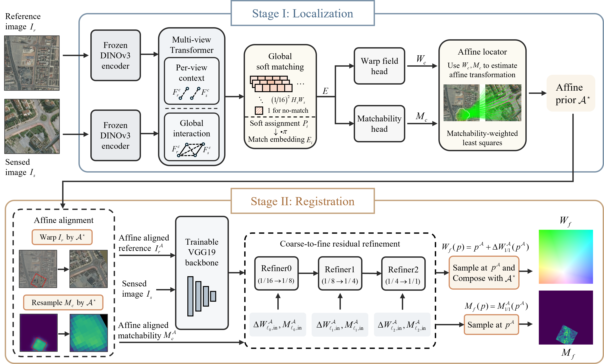

# LoRetta: Localization-and-Registration Foundation Model for Global-Scale Dense Image Matching

<p align="center">
  
</p>

**LoRetta** is a foundation model for dense image matching in remote sensing imagery. It introduces a *localization-and-registration* paradigm: first localize the matchable overlap with an affine prior, then refine dense correspondences within the aligned frame. On the LEVIR-GM benchmark, LoRetta achieves **83.3% AUC** — outperforming RoMa v2 by 1.6 points with **47.8% lower latency**.

[](https://personal-blog.yusiwei77-star.workers.dev/work/loretta/)
[](LICENSE)
[](https://www.python.org/)
[](https://huggingface.co/BRoss123/LoRetta)

📖 **Paper** · [Project Page](https://personal-blog.yusiwei77-star.workers.dev/work/loretta/) · [🤗 Model](https://huggingface.co/BRoss123/LoRetta)

## Installation

```bash
git clone https://github.com/yusiwei77-star/LoRetta.git
cd LoRetta
pip install -e .
```

Requires **Python ≥ 3.10** and **PyTorch ≥ 2.6**. The pretrained checkpoint is automatically downloaded from HuggingFace Hub on first use.

## Quick Start

```bash
python demo.py --reference-image assets/reference.jpg --sensed-image assets/sensed.jpg
```

This warps `sensed.jpg` into the coordinate frame of `reference.jpg` and saves the results to `outputs/`:
- `dense_registered.png` — warped sensed image
- `matchability.png` — per-pixel confidence heatmap

### CLI options

| Option | Default | Description |
|---|---|---|
| `--reference-image` | `assets/reference.jpg` | Reference image path |
| `--sensed-image` | `assets/sensed.jpg` | Sensed (query) image path |
| `--checkpoint` | *(auto-download)* | Local checkpoint path |
| `--output-dir` | `outputs` | Output directory |
| `--device` | `auto` | `auto` / `cuda` / `cpu` |
| `--estimate-geometry` | *(off)* | Also estimate a homography via RANSAC |
| `--matchability-threshold` | `0.5` | Confidence threshold for RANSAC keypoints |
| `--max-keypoints` | `1000` | Max keypoints for RANSAC |
| `--ransac-threshold` | `16.0` | RANSAC reprojection threshold (pixels) |

### Python API

```python
from src.loretta import LoRetta
from src.config import get_inference_config
from src.inference import load_checkpoint, resolve_checkpoint

config = get_inference_config()
model = LoRetta(config)
load_checkpoint(model, resolve_checkpoint())
model = model.eval().cuda()

output = model({"reference_image": ref, "sensed_image": sensed})
# output["warp_1"]          (B, 2, H, W) dense warp
# output["matchability_1"]  (B, 1, H, W) per-pixel confidence
```

## Citation

```bibtex
@article{yu2026loretta,
  title     = {LoRetta: A Localization-and-Registration Foundation Model and
               Extensive Dataset for Global-Scale Dense Image Matching},
  author    = {Yu, Siwei and Guo, Han and Shi, Zhenwei and Zou, Zhengxia},
  journal   = {IEEE Transactions on Pattern Analysis and Machine Intelligence},
  year      = {2026},
}
```

## License

This project is released under the [Apache 2.0 License](LICENSE). It incorporates third-party components from [DINOv3](https://github.com/facebookresearch/dinov3) (Meta license), [RoMaV2](https://github.com/Parskatt/RoMa) (MIT), and [Torchvision](https://github.com/pytorch/vision) (BSD 3-Clause). See [`THIRD_PARTY_NOTICES.md`](THIRD_PARTY_NOTICES.md) for details.
